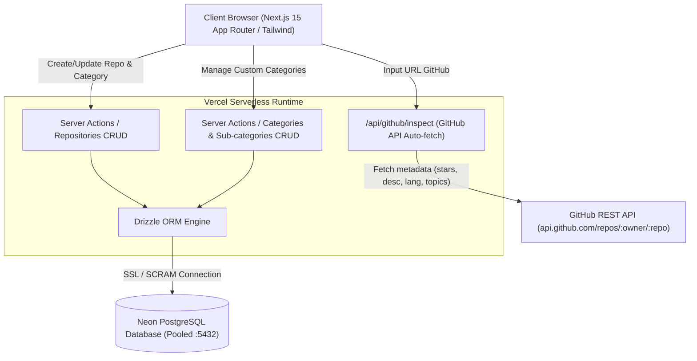

# GitHub Library Hub - Architecture & Design Specification

Dokumen spesifikasi arsitektur dan sistem untuk **GitHub Library Hub**.

---

## 1. Ringkasan Eksekutif & Scope
Platform web katalog curated repository GitHub dengan auto-fetch metadata, kategorisasi 2-level (Category -> Sub-category) fleksibel, filter realtime, dan sidebar navigasi grup hierarki.

- **Frontend & Backend**: Next.js 15 (App Router, Server Actions, Route Handlers).
- **Database**: PostgreSQL (Neon Serverless Pooled) via Drizzle ORM.
- **Styling & UI**: Tailwind CSS, Shadcn UI / Lucide Icons.
- **Deployment**: Vercel ready (Serverless Edge/Node runtime).
- **Access Model**: Publik / Single Personal Library Dashboard (tanpa login).

---

## 2. Arsitektur Sistem



---

## 3. Schema Database (Drizzle ORM)

### Schema DDL
```typescript
// categories table
export const categories = pgTable("categories", {
  id: serial("id").primaryKey(),
  name: varchar("name", { length: 100 }).notNull().unique(),
  slug: varchar("slug", { length: 120 }).notNull().unique(),
  icon: varchar("icon", { length: 50 }).default("folder"),
  sortOrder: integer("sort_order").default(0),
  createdAt: timestamp("created_at").defaultNow().notNull(),
});

// sub_categories table
export const subCategories = pgTable("sub_categories", {
  id: serial("id").primaryKey(),
  categoryId: integer("category_id").references(() => categories.id, { onDelete: "cascade" }).notNull(),
  name: varchar("name", { length: 100 }).notNull(),
  slug: varchar("slug", { length: 120 }).notNull(),
  createdAt: timestamp("created_at").defaultNow().notNull(),
});

// repositories table
export const repositories = pgTable("repositories", {
  id: serial("id").primaryKey(),
  url: text("url").notNull().unique(),
  owner: varchar("owner", { length: 120 }).notNull(),
  repoName: varchar("repo_name", { length: 120 }).notNull(),
  description: text("description"),
  stars: integer("stars").default(0),
  forks: integer("forks").default(0),
  language: varchar("language", { length: 50 }),
  topics: text("topics").array(), // array of strings
  customNotes: text("custom_notes"),
  categoryId: integer("category_id").references(() => categories.id, { onDelete: "set null" }),
  subCategoryId: integer("sub_category_id").references(() => subCategories.id, { onDelete: "set null" }),
  createdAt: timestamp("created_at").defaultNow().notNull(),
  updatedAt: timestamp("updated_at").defaultNow().notNull(),
});
```

---

## 4. UI & Fitur Utama

1. **Sidebar Navigation**:
   - Menu "All Repositories".
   - Accordion Tree: Main Category (LLM, RAG, Video, AI Agent, AI Skill, Custom) -> Sub-categories.
   - Counter badge jumlah repo per kategori dan sub-kategori.
   - Tombol `+ Kategori Baru` dan `+ Sub-kategori`.
2. **Top Bar & Search**:
   - Global search (nama repo, deskripsi, tag/topics, bahasa).
   - Tombol "+ Add Repository".
3. **Modal Add Repository**:
   - Field Input: URL GitHub (`https://github.com/owner/repo`).
   - Tombol "Auto Fetch" / Trigger on paste: memanggil `/api/github/inspect`.
   - Preview Card auto-fill (Stars, Forks, Language, Tags, Description).
   - Dropdown Category & Sub-category (dengan opsi inline tambah custom kategori baru).
   - Tombol Simpan.
4. **Repository Grid Card**:
   - Tampilan Card responsif berisi: Nama Repo (link luar), Badge Stars/Forks, Bahasa, Deskripsi, Kategori/Sub-kategori, Tombol Quick Delete / Move Category.

---

## 5. Seed Data Default Kategori
- **LLM**: Foundations, Fine-tuning, Quantization, Prompt Engineering.
- **RAG**: Vector DBs, Frameworks, Evaluation, Chunking.
- **Video**: Video Generation, Video Editing, Motion, 3D.
- **AI Agent**: Frameworks, Multi-Agent, Autonomous Loops, Memory.
- **AI Skill**: Agent Tools, Coding Skills, MCP Servers, Prompts.

